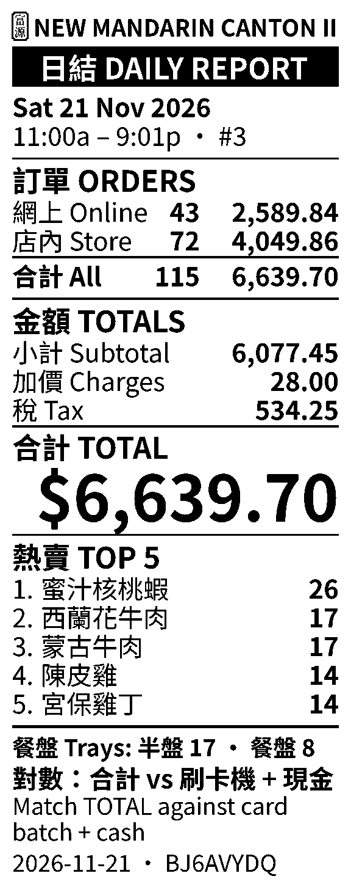
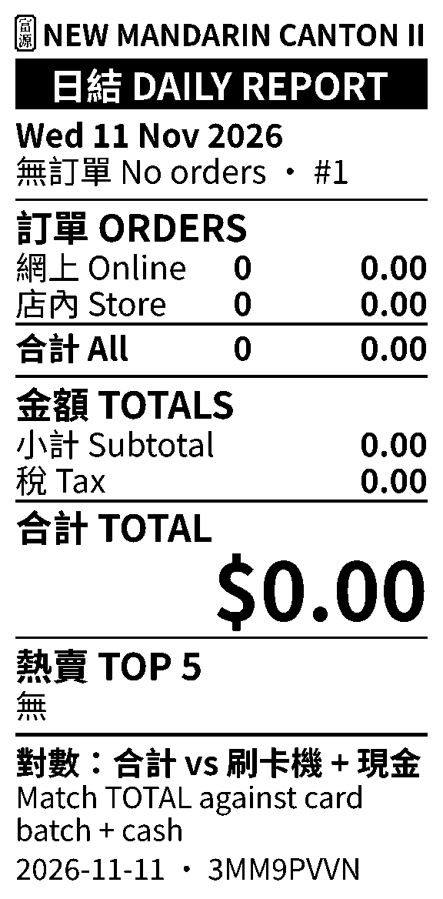

# 日結 Daily Report

A printed end-of-day ORDERS report on the 80mm ticket printer: one receipt,
in type the owner can read at arm's length without glasses.

Status: **built, v2 (2026-11-27).** History → 日結 Day report opens the print
sheet; the numbers come from one SQL aggregate, the paper from the ticket
renderer, and the print goes through the ticket pipeline as its own `report`
kind, offered once and never retried. v1 (2026-11-23) set every row at the
ticket's 22px money size with Online / Store / All money columns; v2 is the
same data, query, sheet and print path with **bigger type and fewer blocks**:
nothing smaller than the kitchen ticket's 中文 dish name, at most three
columns, and NOT INCLUDED, BY HOUR, Family dinners and the optional-block
toggles gone. The four PNGs below are `npm run report:sample`, rendered
through the real ticket renderer.

| Normal Saturday | Slow Monday | 3 cancellations | Empty day |
| --- | --- | --- | --- |
|  |  |  |  |
| 115 counted, 182 mm (v1 218) | 12 counted, no trays, 176 mm (v1 193) | 48 counted, Top 5 merges 陳皮雞 8+7 and 蒙古牛肉 8+5, 182 mm (v1 207) | 0 orders, 146 mm (v1 141) |

**Paper length.** The v2 brief asked for about half the v1 length. At this
type size that is not reachable with what the report keeps: about 18 body
lines, four titles, the band and the TOTAL figure come to roughly 180 mm
however tightly they are set. Halving the length would need body type near
v1's 22-24px. The paper is 12-15% shorter on a real day; the empty day is
slightly longer, as every block now prints at the larger size.

## What it is, and is not

The owner prints a card terminal batch report today (tenders, VISA/MC, tips).
This system never takes payment: online orders pay at pickup, and the POS
prints tickets. So this is an **orders** report, made to lie next to the card
batch and the cash drawer so the three can be checked against each other. The
footer says so in one line: *對數：合計 vs 刷卡機 + 現金 / Match TOTAL against
card batch + cash.*

It has no tenders, no tips, no card totals and no cash count. It cannot say
whether an order was paid, only that it was taken and reached the kitchen.

## Files

| File | What it is |
| --- | --- |
| `src/lib/reports/dailyModel.ts` | Pure. The `DailyReport` shape, every counting rule, the reference aggregation `summarizeDay`, `topDishes` (the printed TOP 5, merged by dish), the formatters and `reportProblems` (the invariants). No database, no clock, no `server-only`. |
| `src/lib/menu/dishKey.ts` | Pure. `dishKey(item)`: an item's canonical dish, by its 中文 name, so the Specials copy and the numbered copy of a dish are one. |
| `src/lib/ticket/report.ts` | `composeReportSvg` / `renderReportPng`: `DailyReport` to 80mm PNG on the ticket's own canvas, metrics, font and rasterizer. |
| `src/lib/ticket/glyphs.ts` | `REPORT_LABELS`: every 中文 string the report prints, fed into the subset. |
| `src/lib/ticket/layout.ts` | One new primitive, `graphic()`, used for the seal. No ticket calls it. |
| `scripts/fixtures/orders.ts` | `reportFixtureDays()`: four seeded days built through the real catalogue. |
| `scripts/report-sample.ts` | `npm run report:sample`. Renders the PNGs to `docs/daily-report/` and fails on any broken invariant, overflowing line or missing glyph. |
| `src/lib/reports/daily.ts` | Server-only. `readDailyReport`: the day in ONE SQL statement (see "How it is built"). |
| `src/lib/reports/prints.ts` | Server-only. The `report_prints` queue: request (idempotent), claim once, settle, confirm. |
| `src/lib/reports/sheet.ts` | Server-only. The print sheet's guard, date parsing, print body and its JSON. |
| `src/app/api/kitchen/reports/daily/**` | The three staff routes: JSON, preview PNG, print. |
| `src/app/api/print/[secret]/route.ts` | The CloudPRNT route, now also offering, serving and confirming report prints. |
| `src/components/kitchen/DailyReportSheet.tsx` | The sheet, opened from `OrderHistory.tsx`. |
| `src/lib/db/migrations/016_report_prints.sql` | `report_prints`, and `print_deliveries` naming an order OR a report. `down_016_to_015.sql` undoes it. |
| `scripts/verify-daily-report.ts` | `npm run verify:daily-report`. |
| `tests/e2e/kitchen-daily-report.spec.ts` | The sheet in a browser, kitchen-tablet and kitchen-ipad. `scripts/report-preview.ts` draws its preview for the spec. |

The subset font was rebuilt (`npm run build:ticket-font`) for v1 to add the 14
glyphs the report needed, and again for v2: it adds 對數刷卡機現 and the
full-width colon ： for the reconcile line, and drops 入列堂未段消食, which only
the removed labels (未計入, 未列印, 取消, 時段, 堂食) used. `verify:ticket-glyphs`
now walks the report's own fixed lines too and passes.

## Data definitions

All money is integer cents, read from the stored `totals` and `items` jsonb.
Nothing is recomputed: tax is the stored tax, total is the stored total.

### The day

A report is for one **business date**: the rows whose `orders.business_date`
equals it. That column is written once, at order creation, by
`businessDateFor(tenant timezone)` in `src/lib/orders/businessDate.ts`, and it
is the same date the order number sequence (A-001, B-001) resets on. The
report never re-derives a date from `created_at`, so it can never disagree with
the order numbers or with History.

The default day is today in the tenant timezone. Any past day can be chosen;
no future day.

**Decided: the 4am rule.** `businessDate.ts` is the plain local calendar
date, with no rollover hour, so a 12:10am order is stored on the new date and
numbered B-001 of the new day. The report keeps to the stored `business_date`
(one truth, the one the order numbers use), and the print sheet **opens on
yesterday** when it is opened between 00:00 and 04:00
(`defaultReportDate`, `REPORT_DAY_ROLLOVER_HOUR`). A 4am rollover inside
`businessDateFor` would change order numbering, the board and History too, so
it stays its own change if it is ever wanted. `verify:daily-report` asserts
both halves: the 12:10am order is the next day's, and the sheet opened at
12:10am is on the day before.

### Channels and stations

From `ORDER_CHANNELS` (`src/lib/orders/types.ts`) and `CHANNEL_STATION`
(`src/config/stations.ts`), never restated:

| Channel | Station | Report row |
| --- | --- | --- |
| `web` | online | 網上 Online |
| `phone` | store | 店內 Store |
| `walk_in` | store | 店內 Store |
| `dine_in` (retired 2026-11-14) | store | 店內 Store |

The paper has **two tills, not three channels**: the owner reconciles the
online orders and the counter, so phone and walk-in (and dine-in on a day
before 2026-11-14) print as one 店內 Store line, which is the `store` station
column. Online + Store = All on every row. The per-channel buckets are still
in the data (`report.channels`) and in the sheet's JSON.

### Which orders count

`OrderStatus` has six values and no "refused".

| Status | Where it goes |
| --- | --- |
| `PRINTED`, `ACCEPTED`, `COMPLETED` | **Counted.** It reached the kitchen (printer confirmed, kitchen took it, or it was handed over). |
| `QUEUED`, `PRINT_FAILED` | **Not counted (unprinted).** Not on paper at print time; the kitchen may still be cooking it. An order that failed to print and was then taken by the kitchen (接單) is `ACCEPTED` and counts. |
| `CANCELLED` | **Not counted (cancelled).** |

Both are still summed into the data (`report.cancelled`, `report.unprinted`,
with their would-be stored totals) and are part of the code; since v2 the
paper does not print them (the NOT INCLUDED block is gone).

Status is read at the moment the report is built, so an order still `QUEUED`
at 9:02pm moves into the counted rows on a reprint at 9:10pm. The print number
and code show that this happened (see Print sequence).

### Add-on tickets

`orders.is_addon` (migration 010) marks a 加菜 round for a seated table. There
is **no parent id column**: an add-on is its own row on the same `dine_in`
channel as the table's first ticket. So "fold into the parent's channel and
totals" is done by channel: an add-on's money goes into its channel's row, its
station column and All, and into its hour; it adds **0** to every count. Only
dine-in rows can be add-ons, so this only matters for days before 2026-11-14.

### Subtotal, Charges, Tax, Total

How `totals` stores a custom charge (`src/lib/kitchen/customCharge.ts`):

- a **custom line** (自訂 Custom) is an ordinary line with `custom: true` and
  item id `custom`; its `lineCents` is in the stored subtotal;
- a **surcharge** (加價 on a dish line) is a modifier with id `surcharge`
  whose price is already inside the line's `unitCents`, so `priceCents ×
  quantity` of it is in the line total and in the stored subtotal.

So, per order (the paper prints these for All only):

    Charges 加價 = Σ custom lineCents + Σ surcharge priceCents × quantity
    Subtotal 小計 = stored subtotalCents − Charges
    Tax 稅        = stored taxCents
    Total 合計    = stored totalCents

Charges are lifted **out of** the subtotal, never added on top, so nothing is
counted twice and Subtotal + Charges + Tax = Total on every column, to the
cent. 加價 Charges prints only when it is not zero. Tip is dormant (every
writer stores 0); a 小費 Tip row prints only if a day ever has one, so the
column still adds up.

### Trays 餐盤

Quantities, not lines, on counted orders only.

- **Half tray 半盤**: lines with size id `half-tray`.
- **Party tray 餐盤**: lines with any other `TRAY_SIZE_IDS` size (today only
  `party-tray`; a capacity added later counts here until it gets a row).
- **Family dinners 家庭餐**: lines whose item id is in the `family-dinners` or
  `big-family-dinner` combo categories (`familyDinnerItemIds()`, passed to
  SQL as a parameter). Still counted in the data; **not printed** since v2.

The paper prints one footer line, `餐盤 Trays: 半盤 5 · 餐盤 4`, and leaves it
out when both are zero.

### 熱賣 TOP 5

The data (`report.top`) is unchanged: the top 10 **catalogue items**, grouped
by item id with sizes merged, sorted by quantity, then sales, then item id.
Sales excludes surcharges (they are Charges); custom lines are left out.

The paper prints `topDishes(report)`: those items **merged by dish**, then the
first five. A dish is its 中文 name (`dishKey` in `src/lib/menu/dishKey.ts`),
so the Specials copy and the numbered copy of the same dish are one line:

| Dish | Catalogue ids |
| --- | --- |
| 陳皮雞 | `orange-flavored-chicken-special`, `orange-flavored-chicken` |
| 椒鹽雞翼 | `salted-pepper-chicken-wings-special`, `salted-pepper-chicken-wings` |
| 蒙古牛肉 | `mongolian-beef-special`, `mongolian-beef` |
| 椒鹽鮮魷 | `salted-pepper-squid-special`, `salted-pepper-squid` |
| 午市套餐 | `combo-lunch-15-75`, `combo-lunch-16-25` |
| 大家庭套餐 | `combo-big-family-128`, `combo-big-family-178` |

The last two are different products at different prices that share a 中文
name; with English gone from the line they would print identically, so they
merge too. Merged dishes sort by quantity, then sales, then key. Each line is
the 中文 name and the quantity: no English, no sales column. A dish with no
中文 name prints its English.

**Known limit.** The merge reads the stored top 10 items, so a dish whose two
copies **both** rank below 10th is not seen, even if together they would make
the top 5. Grouping by dish in the SQL aggregate and `summarizeDay` would close
it; v2 kept the data and query as they were.

### By hour 時段

Still in the data (`report.hours`, and `reportProblems` checks it sums to
All); **not printed** since v2.

### Header window

`11:00a – 9:01p` is the first to the last order created that day, **any
status**, cancelled included (it is when the shop was taking orders). An empty
day prints `無訂單 No orders`. The print time, station and address lines are
gone since v2; the #N rides the window line.

### Print sequence and code

Each print of a given day gets the next number, #1, #2 and so on, per (tenant,
business date). The code is an 8-character fingerprint (FNV-1a, Crockford
base32, no I L O U) of **every number on the report**, not of the print. So:

- two prints with the same code printed the same numbers;
- a later print with a different code means orders changed in between (a late
  order printed, one was cancelled), and the higher # is the one to keep.

Nothing else on the paper calls out a change, as the spec asks. The #N prints
in the header (`11:00a – 9:01p · #3`) and the code on the last line
(`2026-11-21 · BJ6AVYDQ`).

## Layout

80mm (576px at 203dpi), 20px padding, 536px content: the ticket's own paper,
canvas, subset font, and black-on-white thermal rules (nothing under 3px).

### Type

The floor is the kitchen ticket's 中文 dish name (`NAME_ZH_SIZE`, 38 bold in
render.ts). Nothing on the report is smaller.

| Size | Use |
| --- | --- |
| 38 | The floor: the restaurant name (bold), the footer's English line and the date + code line |
| 42 regular | Row labels, the order window, Top 5 dish names |
| 42 bold | Every number (counts, money, quantities), the date, the All row, the trays and reconcile lines |
| 48 bold | Section titles, the 日結 DAILY REPORT band (inverted) |
| 104 / 96 / 88 / 84 bold | The 合計 TOTAL figure: the largest that fits the paper, never under 2x body (84). `$12,345.67` takes 96. |

Body rows are set at 1.12x line height (numbers, not prose). Rules: 3px
between sections and above the All and TOTAL rows, 5px above the footer.

### Blocks, in order

1. **Header.** The 富源 seal (46px tall, frame held at 3px) and
   `NEW MANDARIN CANTON II` at 38 bold on one line; the `日結 DAILY REPORT`
   band; then `Fri 27 Nov 2026` and `12:04p – 7:43p · #1`. The brief asked for
   date, window and # on one line; at 38px or more they need 564px of a 536px
   line, so the date takes its own line.
2. **訂單 ORDERS.** `網上 Online`, `店內 Store`, a rule, `合計 All` (bold),
   each with count and total.
3. **金額 TOTALS**, All only. `小計 Subtotal`, `加價 Charges` (only when not
   zero), `稅 Tax`, a rule, `合計 TOTAL` and the TOTAL figure right-aligned
   under it with its `$`.
4. **熱賣 TOP 5.** `1. 蒙古牛肉` … quantity, merged by dish (above). `無`
   when there is nothing.
5. **Footer.** `餐盤 Trays: 半盤 5 · 餐盤 4` (left out when both are zero;
   steps down to the 38 floor if two-digit counts would not fit at 42), then
   `對數：合計 vs 刷卡機 + 現金` and `Match TOTAL against card batch + cash`,
   then `2026-11-27 · <code>`.

Nothing is optional any more, so the print sheet has no block toggles.

**Columns.** At most three: label, count, total. Every count ends on one right
edge (308px) and every money figure on another (536px), down the receipt.
Digits are tabular at each weight, so right alignment lines them up. Table
money drops the `$` (the column says what it is) and groups thousands
(`6,785.90`); only the TOTAL carries `$`. Labels wrap inside their own column
rather than run into a number.

### Language order

**中文 first** on every label (`訂單 ORDERS`, `網上 Online`), as on the kitchen
ticket. v1 followed its mock's English-first order; v2 flips it. The sheet on
the tablet follows the staff language toggle like every other kitchen screen.

No em dashes anywhere on the paper; the window uses an en dash.

## Edge cases

| Case | Behaviour |
| --- | --- |
| No orders at all | Every row prints 0 / 0.00, TOTAL `$0.00`, the window says `無訂單 No orders`, TOP 5 prints `無`. (PNG 4.) |
| No trays | The trays line is left out. |
| Cancellations, still printing | Counted out of every row; not printed since v2 (see "Which orders count"). |
| Specials and numbered copies of a dish | One TOP 5 line with the quantities added. (PNG 3: 陳皮雞 8+7, 蒙古牛肉 8+5.) |
| Historical dine-in | Folds into 店內 Store and All. |
| Add-on tickets | Money in, count 0 (see above). |
| A dish with no 中文 | English alone, as on the ticket. |
| A hand-written or malformed row | Missing totals read as 0, never NaN; a broken report fails `reportProblems` and must not print. |
| Tip ever non-zero | A 小費 Tip row appears so the column still adds up. |
| Two-digit tray counts | The trays line drops to 38px to stay on one line. |
| $10,000+ day | `12,345.67` fits the money column at 42 bold; the TOTAL drops from 104 to 96. |

## Reading it next to the card batch

At close, lay three things side by side: this report, the card terminal's
batch report, and the counted cash drawer.

1. **Is the day finished?** The paper no longer lists unprinted tickets.
   Before printing, check the board for a ticket still waiting for the printer
   or one that failed; sort it out first. A reprint gets the next # and, if
   anything changed, a new code.
2. **The one number to match** is **合計 TOTAL**: every order taken and sent
   to the kitchen, tax included. Card batch total (before tips) plus the cash
   taken should come close to it. That is the footer's 對數 line.
3. **Why they differ, in the usual order:**
   - **Tips.** The batch total includes card tips; this report has none. Use
     the batch's total before tips.
   - **Not yet paid, or never paid.** An online order paid at pickup is here
     from the moment it printed. One not picked up by close is here and in
     neither the batch nor the drawer.
   - **Cancelled after payment.** Cancelled orders are not in TOTAL; a refund
     on the terminal is.
   - **加價 Charges** are already inside TOTAL. They are shown on their own
     only so typed-in money (custom lines, surcharges) is visible.
4. **網上 Online / 店內 Store** split the same total by till: Online = web
   orders, Store = phone plus walk-in. They always add up to All.
5. **Keep the highest #.** Two prints of one day with the same code printed
   the same numbers. A higher # with a different code means orders changed
   in between; the higher one is the true one.

## How it is built

### One SQL statement

`readDailyReport` (src/lib/reports/daily.ts) sums the day where the rows live.
CTEs: the day's rows classed sold / unprinted / cancelled by status; a lateral
`jsonb_array_elements(items) with ordinality` giving every line's quantity,
line total and 加價 share; each order's charges from its lines; then one row of
jsonb with the buckets by (class, channel), trays, the top 10 (`collate "C"`
for the tie-break), the local-hour buckets (`created_at at time zone`), and
the first and last order. The TypeScript side only adds each bucket into its
channel, its station and All, once each, so Online + Store = All by
construction. `verify:daily-report` proves it equals `summarizeDay` exactly.

### The `report` print kind

A Print press inserts one `report_prints` row (QUEUED) with the report **as
summed at that moment** stored on it; the paper is rendered from that row,
never re-summed. The printer's poll (src/app/api/print/[secret]/route.ts):

- **Tickets first.** A printer takes a report only when it has no ticket in
  flight and none waiting, and while a report is in flight it is handed no
  ticket. One job at a time, as for orders.
- **Same hand-over, same audit.** Claiming writes one `print_deliveries` row
  (reason `report`, `order_id` null, `report_print_id` set); its id is the job
  token, the R2 key and what the DELETE echoes. A fetch is counted; a fetch
  after confirmation is 410. So one press is one piece of paper.
- **Offered once.** Success → PRINTED. A failure code, a render failure or a
  window that runs out → FAILED, and **nothing re-offers it**: there is no
  report branch in the retry, cap or paper-restored requeue. A person prints
  it again from the sheet, as the next #. A success arriving after FAILED is
  still recorded as PRINTED (the paper came out).
- **Window**: the one-copy ticket window (`confirmationWindowSeconds(1, …)`),
  whatever TICKET_COPIES is.
- **Which printer**: the station picked on the sheet, printed by whichever
  printer serves that station (a one-printer shop prints Store reports on its
  only printer). Never by failover: a report for a silent printer waits, and
  the sheet says that printer is offline.
- **Before 016**: every report call in the poll is wrapped; a missing table is
  "no report", so tickets never wait on this feature.

### The sheet and its routes

History's header has **日結 Day report** beside Export CSV. The sheet:
◀ date ▶ (a day at a time, nothing past today, opening as above), the printer
(Store by default), the day's earlier prints with their status, and the
preview, which is the renderer's own PNG for exactly these choices and the
next #. The optional-block toggles are gone (v2): nothing is optional. **Print #N** is disabled, with the reason, while
that printer is out of paper, has its cover open or is offline, or before
migration 016. Routes (staff session only; the print POST is also host-gated
like every route that puts paper in the kitchen):

| Route | What |
| --- | --- |
| `GET /api/kitchen/reports/daily[?date=]` | The report JSON, `nextSequence`, the day's prints, printer health, `printable`. |
| `GET /api/kitchen/reports/daily/preview?date=&station=&sequence=` | The receipt as a 1-bit PNG, 576 px wide; `x-report-code` header. |
| `POST /api/kitchen/reports/daily/print` | `{ date, station, sequence, requestKey }`. Same key again: the same print (`replay`). Another key for a taken or skipped #: 409 with `nextSequence`. Printer blocked: 409 with `reason`. Future day: 400. A `blocks` field from a tablet still on the old page is accepted and ignored. |

`report_prints.blocks` (migration 016, `not null`) is kept so no migration was
needed: every print since v2 writes `'{}'`, and rows from before still read.

## Checks

`npm run report:sample` fails (exit 1) on any of:

- Online + Store != All, for count and every money row;
- the channel rows not summing to All;
- Subtotal + Charges + Tax + Tip != stored Total, on any column;
- By hour not summing to All, for count or money (still in the data);
- two TOP 5 lines sharing a name;
- any laid-out line wider than its column or past the paper;
- any glyph drawn as .notdef.

It also prints each day's TOP 5 and the catalogue items it was merged from.
The fixture days order the Specials copies of 蒙古牛肉 and 陳皮雞 so the merge
shows on paper. Current output:

    ok   1-saturday       115 orders   $6,639.70  cancelled 0  unprinted 1  1452px (182mm)  code BJ6AVYDQ
    ok   2-slow-monday     12 orders     $577.63  cancelled 0  unprinted 0  1404px (176mm)  code N538K82P
    ok   3-cancellations   48 orders   $2,968.37  cancelled 3  unprinted 1  1457px (182mm)  code S0TMZHTD
    ok   4-empty-day        0 orders       $0.00  cancelled 0  unprinted 0  1168px (146mm)  code 3MM9PVVN

### Database and pipeline

| Check | Count | What it proves |
| --- | --- | --- |
| `verify:daily-report` | 79/79 | A hand-worked day, every number: add-ons fold, cancelled and unprinted apart, charges and tax to the cent, 9:15pm stays Saturday, 12:10am is Sunday's, other tenants invisible; SQL = `summarizeDay` on the four sample days, and no two Top lines share a nameZh on any of them; **TOP 5 by dish** (v2): every catalogue nameZh is one dish key and the four Specials pairs are one dish each, a hand-worked Monday whose ranking only comes out right merged (蒙古牛肉 3+2 first, 椒鹽雞翼 1+2 third, the sixth dish cut), and the paper itself: each dish printed once, no English dish names, no em dash, NOT INCLUDED / BY HOUR / Family dinners gone, the TOTAL the largest type and at least 84px, nothing under 38px; the sheet's opening day; the three routes (auth, JSON, PNG, idempotent print, 409s, no future days, a print stores `blocks` `'{}'`, an old tablet still sending `blocks` is accepted). |
| `verify:print-deliveries` | 87/87 | Scenarios 13-16: one press is one hand-over, held, fetched, confirmed, 410 after; tickets go first and none is handed out mid-report; the request is idempotent, including two presses at once; tickets still print without migration 016. |
| `verify:print-recurrence` | 6/6 | Real clock: an unconfirmed report is handed over once and ends FAILED, at the shipped window and at the 2s window that makes a ticket print four times. |
| `verify:station-migrations` | 016 section | 016 and its down are repeatable; a Store report prints on 011-016; tickets print after the rollback. **Currently crashes before any of that** on `main` as well as on this change: its production seed inserts into `printer_status`, which `schema.sql` no longer has (`relation "printer_status" does not exist`). |
| `verify:ticket-glyphs` | 0 missing | Walks REPORT_LABELS and the report's own fixed lines (reconcile line, block titles, dates, the code alphabet) besides every ticket string. The v2 font rebuild leaves all 18 `ticket:sample` kitchen tickets byte-identical. |
| Playwright `kitchen-daily-report` | 12/12 (kitchen-tablet + kitchen-ipad; the full kitchen suites 91/92, below) | The sheet shows the seeded day's totals; the preview asks for that day and the next # and sends no `blocks`; the block toggles are gone; the drawn TOP 5 has at most five lines, one per dish, 中文 only; Print's body is exactly `{ date, requestKey, sequence, station }`; Print, pressed twice, enqueues exactly one job; Print is disabled with 缺紙 while the store printer is out of paper, and enabled again on the online printer; no sideways scroll and no target under 44 px with the sheet open at 768x1024, 1024x768, 1180x820 and 1366x1024. The spec also draws that day's preview with `scripts/report-preview.ts`, the same `renderReportPng`, and checks it is 576 px wide with the sheet's count and total. (The preview route itself could not load resvg under `next start` until `src/lib/ticket/resvg.ts` stopped using `require.resolve` for the wasm, fixed when PR #14 merged.) Run on its own the spec passes on both devices; in the full two-project run the iPad's Print test can meet the tablet's print of the same day in the shared database and get #3 where it read #2, as it did once in the v2 run (91 passed, 1 failed). |

## Out of scope

Not built, by design: an email or PDF copy, a weekly view, tips, tenders,
anything about how an order was paid.
