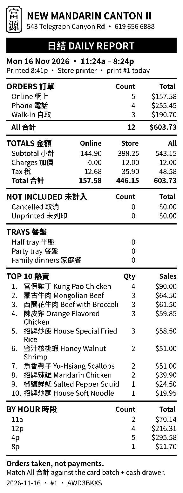
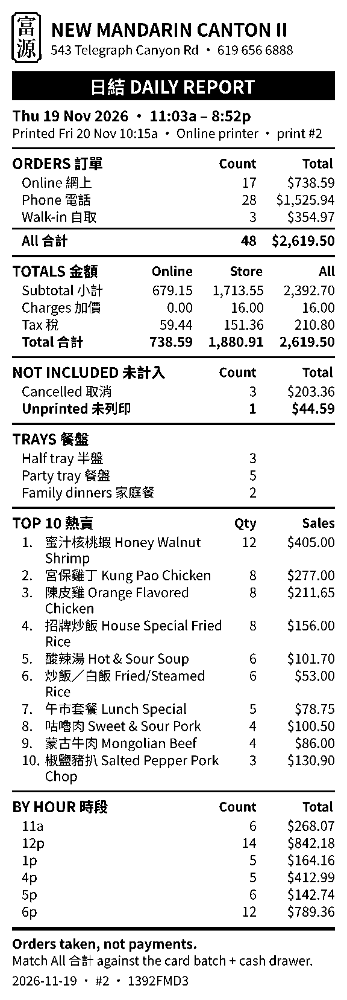

# 日結 Daily Report

A printed end-of-day ORDERS report on the 80mm ticket printer: one receipt,
with Online, Store and All columns.

Status: **Phase 1 (design), awaiting review.** Nothing is wired yet: no SQL,
no route, no print kind, no UI. What exists is the data model, the renderer,
fixtures for four days, and `npm run report:sample`, which renders the four
PNGs below through the real ticket renderer.

| Normal Saturday | Slow Monday | 3 cancellations | Empty day |
| --- | --- | --- | --- |
|  |  |  |  |
| 115 counted, 1 unprinted, 218 mm | 12 counted, no trays, 193 mm | 48 counted, 3 cancelled, 1 failed print, printed next morning on the Online printer, 207 mm | 0 orders, looked up a week later, 141 mm |

## What it is, and is not

The owner prints a card terminal batch report today (tenders, VISA/MC, tips).
This system never takes payment: online orders pay at pickup, and the POS
prints tickets. So this is an **orders** report, made to lie next to the card
batch and the cash drawer so the three can be checked against each other. The
footer says so in words: *Orders taken, not payments. Match All 合計 against the
card batch + cash drawer.*

It has no tenders, no tips, no card totals and no cash count. It cannot say
whether an order was paid, only that it was taken and reached the kitchen.

## Files

| File | What it is |
| --- | --- |
| `src/lib/reports/dailyModel.ts` | Pure. The `DailyReport` shape, every counting rule, the reference aggregation `summarizeDay`, the formatters and `reportProblems` (the invariants). No database, no clock, no `server-only`. |
| `src/lib/ticket/report.ts` | `composeReportSvg` / `renderReportPng`: `DailyReport` to 80mm PNG on the ticket's own canvas, metrics, font and rasterizer. |
| `src/lib/ticket/glyphs.ts` | `REPORT_LABELS`: every 中文 string the report prints, fed into the subset. |
| `src/lib/ticket/layout.ts` | One new primitive, `graphic()`, used for the seal. No ticket calls it. |
| `scripts/fixtures/orders.ts` | `reportFixtureDays()`: four seeded days built through the real catalogue. |
| `scripts/report-sample.ts` | `npm run report:sample`. Renders the PNGs to `docs/daily-report/` and fails on any broken invariant, overflowing line or missing glyph. |

The subset font was rebuilt (`npm run build:ticket-font`) to add the 14 glyphs
the report needs: 日結堂食額價未入消列熱賣段無. Every one of the 18
`ticket:sample` PNGs is byte-identical before and after, and
`verify:ticket-glyphs` passes. The rebuild also dropped 廚房收銀, the retired
KITCHEN / REGISTER copy-bar labels, which no code prints any more (they appear
only in comments in render.ts and copies.ts); the subset now matches glyphs.ts
exactly.

## Data definitions

All money is integer cents, read from the stored `totals` and `items` jsonb.
Nothing is recomputed: tax is the stored tax, total is the stored total.

### The day

A report is for one **business date**: the rows whose `orders.business_date`
equals it. That column is written once, at order creation, by
`businessDateFor(tenant timezone)` in `src/lib/orders/businessDate.ts`, and it
is the same date the order number sequence (A-001, B-001) resets on. The
report never re-derives a date from `created_at`, so it can never disagree with
the order numbers or with History.

The default day is today in the tenant timezone. Any past day can be chosen;
no future day.

> **Open question 1, the 4am rule.** The spec says a report printed between
> midnight and 4am belongs to the previous business day "if businessDate says
> so", and Phase 2's verify list asks that a 12:10am order land on the previous
> day. **businessDate.ts does not say so today**: it is the plain local calendar
> date, with no rollover hour. A 12:10am order is stored on the new date and
> numbered B-001 of the new day.
>
> Recommended: keep the report on the stored `business_date` (one truth, the
> one the order numbers use), and make the print sheet **default** to
> yesterday when opened between 00:00 and 04:00. The alternative, a 4am
> rollover inside `businessDateFor`, changes order numbering, the board and
> History as well, so it is its own change. The restaurant closes by 9:30pm,
> so neither case has happened yet. I need your call before Phase 2's verify
> asserts either behaviour.

### Channels and stations

From `ORDER_CHANNELS` (`src/lib/orders/types.ts`) and `CHANNEL_STATION`
(`src/config/stations.ts`), never restated:

| Channel | Station | Report row |
| --- | --- | --- |
| `web` | online | Online 網上 |
| `phone` | store | Phone 電話 |
| `walk_in` | store | Walk-in 自取 |
| `dine_in` (retired 2026-11-14) | store | Dine-in 堂食, **only on a day that has one** |

Store = phone + walk_in + dine_in. Online + Store = All on every row.

### Which orders count

`OrderStatus` has six values and no "refused".

| Status | Where it goes |
| --- | --- |
| `PRINTED`, `ACCEPTED`, `COMPLETED` | **Counted.** It reached the kitchen (printer confirmed, kitchen took it, or it was handed over). |
| `QUEUED`, `PRINT_FAILED` | **Not included: Unprinted 未列印.** Not on paper at print time; the kitchen may still be cooking it. An order that failed to print and was then taken by the kitchen (接單) is `ACCEPTED` and counts. |
| `CANCELLED` | **Not included: Cancelled 取消**, with its would-be stored total. |

Status is read at the moment the report is built, so an order still `QUEUED`
at 9:02pm moves into the counted rows on a reprint at 9:10pm. The print number
and code show that this happened (see Print sequence).

### Add-on tickets

`orders.is_addon` (migration 010) marks a 加菜 round for a seated table. There
is **no parent id column**: an add-on is its own row on the same `dine_in`
channel as the table's first ticket. So "fold into the parent's channel and
totals" is done by channel: an add-on's money goes into its channel's row, its
station column and All, and into its hour; it adds **0** to every count. Only
dine-in rows can be add-ons, so this only matters for days before 2026-11-14.

### Subtotal, Charges, Tax, Total

How `totals` stores a custom charge (`src/lib/kitchen/customCharge.ts`):

- a **custom line** (自訂 Custom) is an ordinary line with `custom: true` and
  item id `custom`; its `lineCents` is in the stored subtotal;
- a **surcharge** (加價 on a dish line) is a modifier with id `surcharge`
  whose price is already inside the line's `unitCents`, so `priceCents ×
  quantity` of it is in the line total and in the stored subtotal.

So, per order:

    Charges 加價 = Σ custom lineCents + Σ surcharge priceCents × quantity
    Subtotal 小計 = stored subtotalCents − Charges
    Tax 稅        = stored taxCents
    Total 合計    = stored totalCents

Charges are lifted **out of** the subtotal, never added on top, so nothing is
counted twice and Subtotal + Charges + Tax = Total on every column, to the
cent. Tip is dormant (every writer stores 0); a Tip 小費 row prints only if a
day ever has one, so the column still adds up. Online orders cannot carry a
charge (the web checkout has no price field), so Online Charges is always 0.00.

### Trays 餐盤

Quantities, not lines, on counted orders only.

- **Half tray 半盤**: lines with size id `half-tray`.
- **Party tray 餐盤**: lines with any other `TRAY_SIZE_IDS` size (today only
  `party-tray`; a capacity added later counts here until it gets a row).
- **Family dinners 家庭餐**: lines whose item id is in the `family-dinners` or
  `big-family-dinner` combo categories. Lines store no category, so the id
  set is read from `comboCategories()` (`familyDinnerItemIds()`); a new set is
  counted the day it is added. Phase 2 passes the list to SQL as a parameter.

### Top 10 熱賣

Counted orders, grouped by item id with sizes merged, sorted by quantity, then
sales, then item id (so a tie never reorders between prints). Sales is the sum
of line totals **excluding surcharges**, which are Charges. Custom lines are
not dishes and are left out. Name is 中文 then English, from the order lines
themselves.

Edge: the two lunch-special ids both print as 午市套餐 Lunch Special. They are
different items with different prices, so they stay two rows.

### By hour 時段

Counted orders by the restaurant-local hour of `created_at`, one row per hour
that has at least one; closed or empty hours are left out. Counts and totals
sum to All exactly (add-ons add money and no count, as above).

### Header window

`Sat 21 Nov 2026 · 11:00a – 9:01p` is the first to the last order created that
day, **any status**, cancelled included (it is when the shop was taking orders).
An empty day prints `no orders`.

> **Open question 2.** The spec says "first-order to last-order (or print time
> if later)". For today's report the print time is always later, so that rule
> would always print the print time, which the spec's own mock does not do
> (9:01p in the window, 9:02p printed). I followed the mock: the window is
> first to last order, and the print time has its own line.

### Print sequence and code

Each print of a given day gets the next number, #1, #2 and so on, per (tenant,
business date). The code is an 8-character fingerprint (FNV-1a, Crockford
base32, no I L O U) of **every number on the report**, not of the print. So:

- two prints with the same code printed the same numbers;
- a later print with a different code means orders changed in between (a late
  order printed, one was cancelled), and the higher # is the one to keep.

Nothing else on the paper calls out a change, as the spec asks.

## Layout

80mm (576px at 203dpi), 20px padding, 536px content: the ticket's own paper,
canvas, subset font, and black-on-white thermal rules (nothing under 3px). The
type scale is the ticket's money block:

| Size | Use | Same as on the ticket |
| --- | --- | --- |
| 30 bold | Restaurant name; the 日結 DAILY REPORT bar (inverted) | 到店付款 COLLECT PAYMENT bar |
| 24 bold | Date line; section titles | 電話 / 取餐時間 labels |
| 22 regular | Every row | 小計 SUBTOTAL / 稅金 TAX rows |
| 22 bold | All 合計, Total 合計, and Unprinted when it is not 0 | |
| 21 regular | Address, printed line, column heads (bold), footer small print | 落單 PLACED line |

Rules: 5px under the header and above the footer, 3px between sections and
above All, matching the ticket's 5px / 3px.

**Columns.** One right edge for every count (406px), one for every money
figure (536px), down the whole receipt. The TOTALS block adds two more edges
118px apart for Online and Store. Digits in this font have equal advances at
each weight (12.21px regular, 12.98px bold at 22px), so right alignment lines
the digits up as tabular figures. Money always shows cents and groups
thousands: `$2,104.50` in count blocks, `1,935.17` (no $) in the three-column
TOTALS block, as the spec draws it. Row labels hang 16px in from their title
and wrap inside their own column rather than run into a number; long dish names
in Top 10 wrap under the name, never under the rank.

**Seal.** The 富源 seal is drawn from `src/lib/brand/seal.ts` (the same
geometry the site uses) in black, 84px tall, with its frame stroke held at the
3px thermal floor (the artwork's stroke would be under a pixel at this size).
It needs no font glyphs.

**Paper.** 141mm empty, about 195 to 220mm on a real day. Top 10 and By hour
are the variable parts; By hour is at most 11 rows for an 11:00 to 9:30 day.

Optional blocks (Trays, Top 10, By hour) default on and are toggled in the
print sheet; ORDERS, TOTALS and NOT INCLUDED always print. An optional block
with nothing to list prints `無 None` rather than vanishing, so an empty Top 10
cannot be mistaken for a block switched off.

### Language order

> **Open question 3.** The spec's layout puts English first (`ORDERS 訂單`,
> `Online 網上`) while its general rules say 中文 first, English second. The
> mock is drawn English-first, so I followed it; the kitchen ticket itself is
> 中文 first (`小計 SUBTOTAL`). Flipping it is one string per row in
> report.ts. Which do you want?
>
> Also from the spec, deliberately kept: **Walk-in 自取** (the kitchen ticket
> header says 到店 for a walk-in) and **Tax 稅** (the ticket says 稅金).

## Edge cases

| Case | Behaviour |
| --- | --- |
| No orders at all | Every row prints 0 / $0.00, window says `no orders`, Top 10 and By hour print `無 None`. (PNG 4.) |
| No trays | Trays prints its three rows at 0. (PNG 2.) |
| Cancellations | Counted out of every row, listed with their would-be stored total under NOT INCLUDED. (PNG 3.) |
| Still printing | QUEUED and PRINT_FAILED under NOT INCLUDED; the Unprinted row goes bold when it is not 0. (PNGs 1 and 3.) |
| Printed on a later day | `Printed Fri 20 Nov 10:15a · Online printer · print #2`, no "today". (PNG 3.) |
| Hours with no orders | Left out of By hour. (PNG 3 has no 2p or 3p.) |
| Historical dine-in | A Dine-in 堂食 row appears on that day only, and folds into Store and All. |
| Add-on tickets | Money in, count 0 (see above). |
| A dish with no 中文 | English alone, as on the ticket. |
| A hand-written or malformed row | Missing totals read as 0, never NaN; a broken report fails `reportProblems` and must not print. |
| Tip ever non-zero | A Tip 小費 row appears so columns still add up. |
| Very long dish name | Wraps inside the name column; numbers stay on its first line. |
| $10,000+ day | `$12,345.67` fits the money column at 22 bold with room. |

## Checks that run today

`npm run report:sample` fails (exit 1) on any of:

- Online + Store != All, for count and every money row;
- the channel rows not summing to All;
- Subtotal + Charges + Tax + Tip != stored Total, on any column;
- By hour not summing to All, for count or money;
- any laid-out line wider than its column or past the paper;
- any glyph drawn as .notdef.

Current output:

    ok   1-saturday       115 orders   $6,785.90  cancelled 0  unprinted 1  1743px (218mm)  code 8E9SS51J
    ok   2-slow-monday     12 orders     $603.73  cancelled 0  unprinted 0  1546px (193mm)  code AWD3BKXS
    ok   3-cancellations   48 orders   $2,619.50  cancelled 3  unprinted 1  1656px (207mm)  code 1392FMD3
    ok   4-empty-day        0 orders       $0.00  cancelled 0  unprinted 0  1126px (141mm)  code 3MM9PVVN

## Phase 2, after review (not started)

1. **Query.** `src/lib/reports/daily.ts` (server-only): one SQL aggregate per
   report, grouped by channel and status, a lateral over `items` jsonb for
   trays and top items, and an hour bucket in the tenant timezone, returning a
   `DailyReport`. `verify:daily-report` builds a known day in the embedded test
   DB (pattern: `scripts/verify-staff-orders.ts`) and asserts every number, and
   that the SQL result equals `summarizeDay` over the same rows: add-ons fold,
   cancelled excluded, the 12:10am case (per open question 1), charges and tax
   to the cent, Online + Store = All on every row.
2. **Print kind.** A `report` kind through render, PNG, print (CloudPRNT on the
   online station, the StarPRNT bridge on the store station), on the
   delivery/dedup tables so one request prints exactly once, and **outside**
   the automatic retry/recurrence path: a failed report is reprinted by a
   person. Extend `verify:print-recurrence` and `verify:print-deliveries`. The
   print sequence needs a small table (tenant, business date, sequence, code,
   station, printed at, delivery id), unique on the first three.
3. **UI.** History tab, 日結 Day report button (top right, 56px like the
   others). Sheet: date (today by default, ◀ ▶, nothing in the future),
   station (Store by default), the three block toggles, a live preview from
   this renderer at tablet size, 列印 Print, disabled with a reason while that
   printer is offline. Strings through `t()` in both dictionaries; tokens from
   docs/kitchen-design.md, no new colours.
4. **Access.** Staff session only (the /kitchen guard).
   `GET /api/kitchen/reports/daily` returns the JSON; a POST enqueues the
   print. Both idempotent on (tenant, date, sequence).
5. **Tests.** Playwright kitchen-tablet and kitchen-ipad: open the sheet,
   preview shows the seeded day's totals, print enqueues one job, and the
   no-sideways-scroll / 44px rules hold with the sheet open at all four
   viewports. Then the full verify:* set, typecheck, typecheck:worker, lint.
6. **Docs.** How to read it next to the card batch; the route in the ops notes.

## Out of scope

Not built, by design: an email or PDF copy, a weekly view, tips, tenders,
anything about how an order was paid.
