# 改單 Edit order: design (Phase 1, for review)

Staff reopen an order from the board, change it on the POS, and the kitchen
gets a **change ticket** that lists only the differences, under the original
number. Nothing here is built yet except the two pure pieces the design
depends on (the diff and the change-ticket renderer), so the ticket images
below come out of the real renderer, font and rasterizer.

| What | Where |
| --- | --- |
| Diff model (pure, client-safe) | `src/lib/orders/revisionDiff.ts` |
| Change-ticket layout | `src/lib/ticket/render.ts` (`options.change`, `options.revision`) |
| New ticket labels, font subset | `src/lib/ticket/glyphs.ts`, `public/fonts/*` (+10 glyphs) |
| Ticket PNGs | `docs/edit-order/ticket-*.png` (`npm run ticket:change-sample`) |
| UI mockups (live app, DOM edited) | `docs/edit-order/mock-*.png` (`node docs/edit-order/shoot.mjs`) |

The 18 existing `ticket:sample` outputs (PNG and StarPRNT) are byte-identical
before and after the renderer change; `verify:ticket-glyphs` passes.

## Why a change ticket and not a reprint

Once a ticket is on paper the wok may be cooking it. A second full ticket
reads as a new order (two get cooked) or makes the cook diff two tickets by
eye. So an edit prints `改單 CHANGE · B-002` with only the + / - / 改 lines,
and the order number never changes. 重印 Reprint stays what it is: one more
copy of the full ticket.

Editing is **not** built on 加菜 (`is_addon`, migration 010). That was a second
ORDER row for a seated party, retired with dine-in; an edit changes the one
order and keeps its history.

## Branch and migration number

- This branch, `edit-order-design`, is cut from `pos-portion-preloader-keypad`
  (PR #13, open), because edit mode is PosScreen as #13 left it: no strip
  defaults, the 份量 portion sheet, the 加飯 #116 side line, `onAdd(draft, extraRice)`.
  **Open question 1** asks where Phase 2 should be cut.
- Migrations: `main` and #13 stop at **015**. PR #14 (`daily-report`, open)
  adds **016** (`016_report_prints.sql`). PR #10 adds none. So this feature
  takes **017** (`017_order_revisions.sql` + `down_017_to_016.sql`), and must
  merge after #14 or be renumbered if #14 is dropped.
- The ticket font: #14 also rebuilds the subset (`public/fonts/*`,
  `font-data.ts`). Whichever merges second **rebuilds** the font rather than
  merging the binaries (`npm run build:ticket-font`).

## A. The board

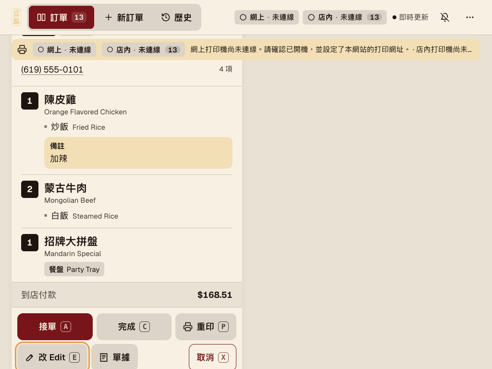

- **改 Edit**, shortcut **E**, sits right after 重印 Reprint in the card's
  action row, same secondary style, pencil icon. Listed in the Shortcuts sheet
  (`shortcuts.edit`).
- Shown for `QUEUED`, `PRINTED`, `PRINT_FAILED`, `ACCEPTED`.
- `COMPLETED`: shown for **30 minutes after `done_at`**, then hidden. Done
  orders leave the board for the compact Recently done list, so in practice
  this is the History card (and the board card during the Undo window).
- `CANCELLED`: never.
- The server enforces the same rule (a stale tablet cannot edit a cancelled
  order); the button is only the visible half.
- Counters on the card, next to `重印 ×N`: `改 ×N` = change tickets this
  order has caused. History cards show `已改 Edited ×N` (= `orders.revision`).

## B. The POS in edit mode

| Editing, one line added, one quantity up | Nothing changed yet |
| --- | --- |
| 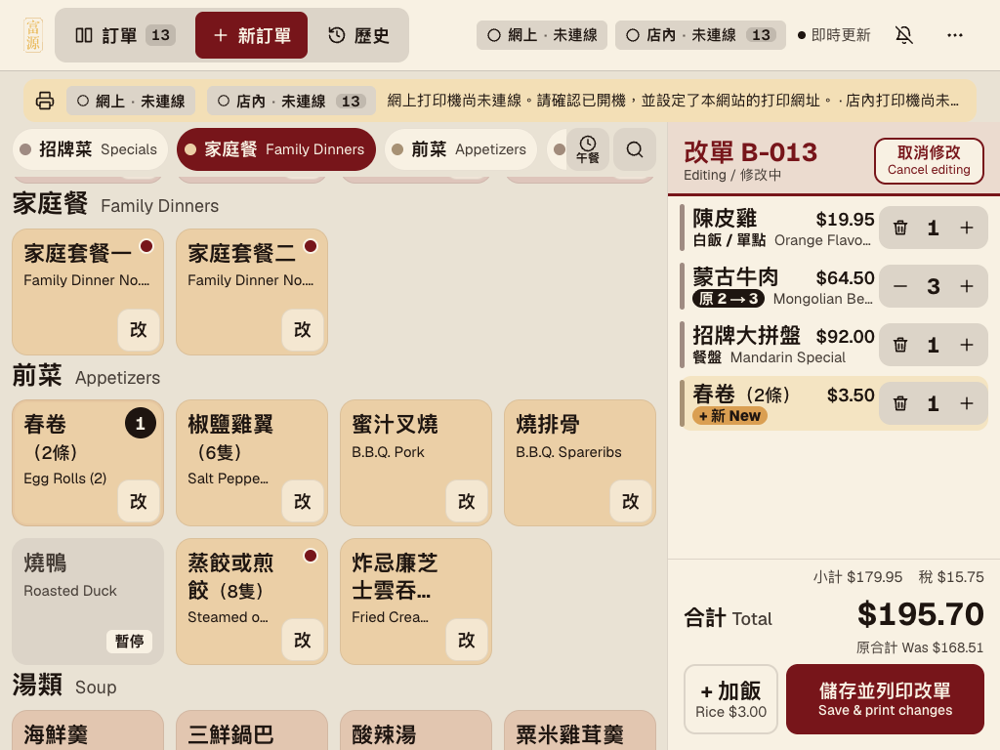 | 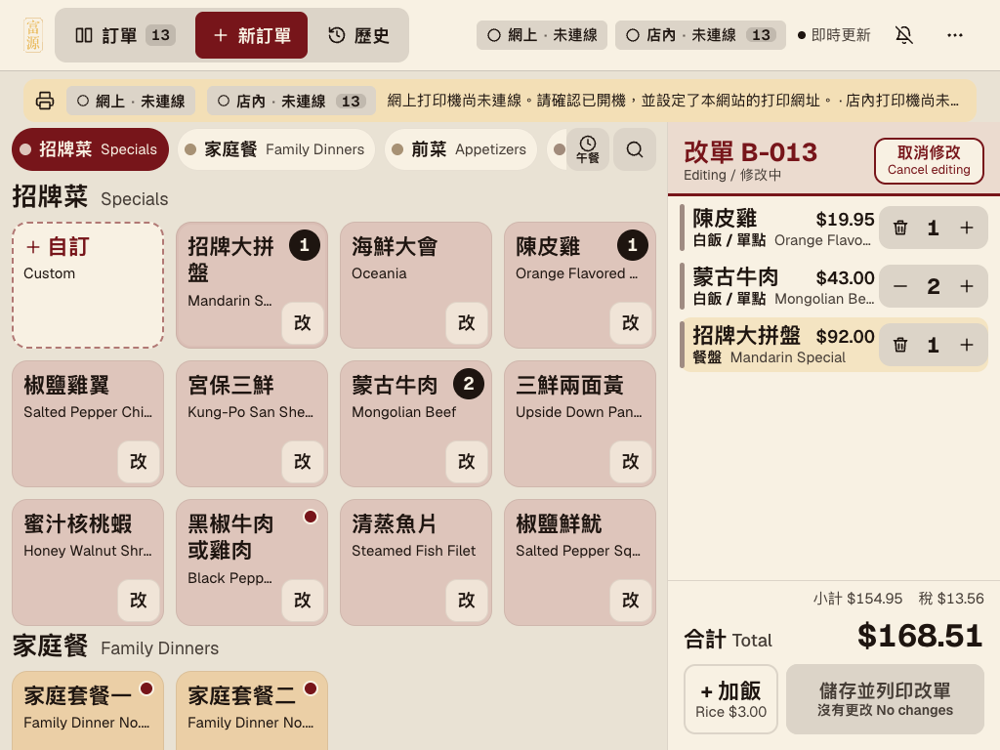 |
| 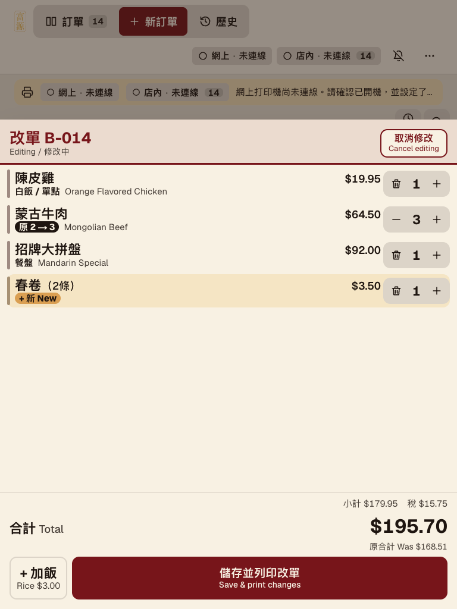 | 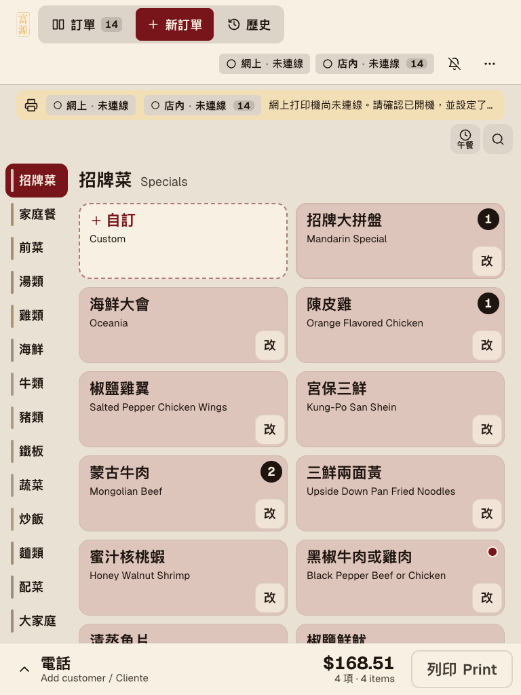 |

- Route: `/kitchen/pos?edit=<orderId>`. The POS loads the order with
  `GET /api/kitchen/orders/<id>` and turns each stored `OrderLine` back into a
  draft line: `itemId`, `sizeId`, `modifierIds`, note; a custom charge back to
  its 自訂 line; a 加價 surcharge modifier back to `surcharge`; the 加飯 #116
  side stays its own line, as the POS made it.
- **Header**: `改單 B-002` large in brand red, `Editing / 修改中` under it,
  and **取消修改 Cancel editing** on the right. The header band is tinted and
  underlined so edit mode cannot be mistaken for a new ticket.
- Cancel editing throws the draft away and returns to the board. Nothing was
  written; the order is untouched.
- Everything the POS does on a new ticket works: add, remove, quantity, 改
  (size, rice, options, note), 自訂 custom charge, 加飯.
- Each line that differs from the order says so on its second row:
  `+ 新 New` (gold) or `原 2 → 3` (ink). Removed lines simply leave the ticket;
  they appear in the confirm sheet.
- Under the total: `原合計 Was $168.51`.
- **Customer, channel, phone, pickup time are read-only** in edit mode. The
  customer row shows them without the 加客人 button; the phone-number nag is
  not shown. Today the only pickup-time control is the POS's "Scheduled for"
  at creation, and there is no control for changing it later, so changing the
  time is out of scope (as the spec allows).
- **Save** reads `儲存並列印改單 / Save & print changes`. With no difference
  it is disabled and reads `沒有更改 No changes`. "No difference" is
  `isEmptyDiff(diffOrderLines(original, draft))` on the client, with the same
  function the server uses.
- Removing every line: Save stays disabled and says
  `不能刪除全部，請用取消訂單 Use Cancel to void the order`. Cancel already exists.
- The draft is not persisted across reloads (unlike a new ticket's draft): an
  edit is short, and a stale edit draft resurrected an hour later against a
  changed order is worse than retyping.

### The confirm sheet

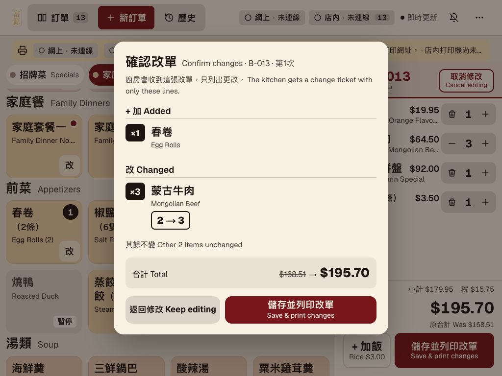

Save opens a sheet that shows exactly what the kitchen will receive, from a
**server dry run** (`POST …/edit` with `dryRun: true`): the server prices the
draft and computes the diff without writing anything, so the totals and blocks
on the sheet are the server's, not the tablet's estimate. Blocks appear only
when non-empty, as on the ticket: `+ 加 Added`, `- 減 Removed` (struck
through), `改 Changed` (`2 → 3`, `餐盤 → 半盤`, `備註 加辣 → 走辣`), then
`其餘不變 Other N items unchanged`, then `合計 $old → $new`.

Buttons: `返回修改 Keep editing` and `儲存並列印改單 Save & print changes`.

Web orders are editable the same way. The sheet adds one line:
`網上訂單：客人到店付款 $old → $new` so whoever is at the counter knows the
customer will be asked for a different amount. On save, the order's staff note
gets a line appended: `已改單 edited by staff, was $168.51` (never printed).

## C. The change ticket

All four cases, both copies as they come off the printer (kitchen copy first,
then the register copy with the `$` badge):

| Original B-002 | + Added | - Removed | 改 Size | 改 Note only |
| --- | --- | --- | --- | --- |
| 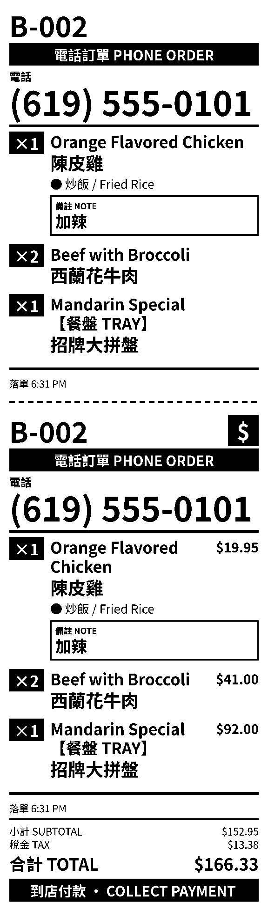 | 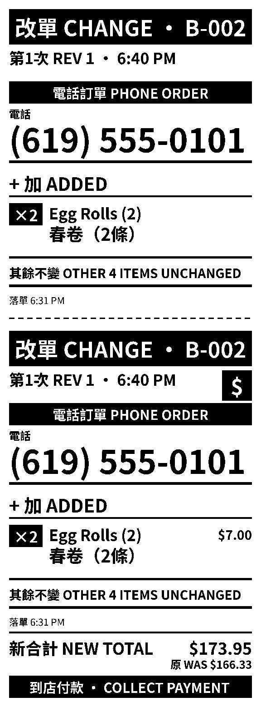 | 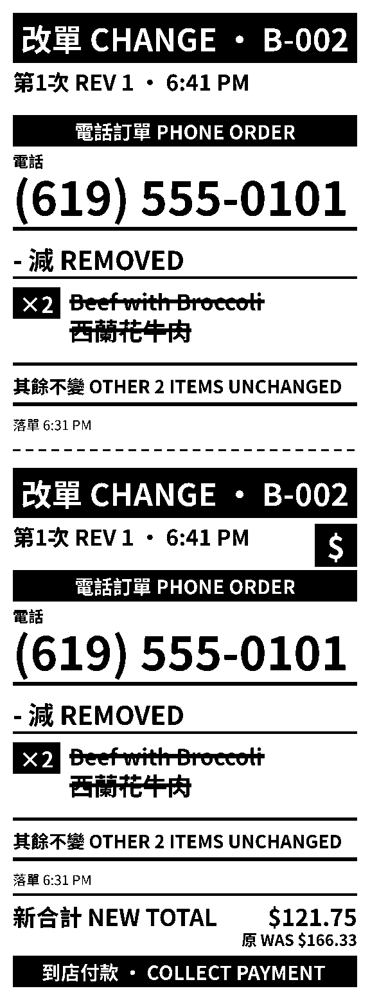 | 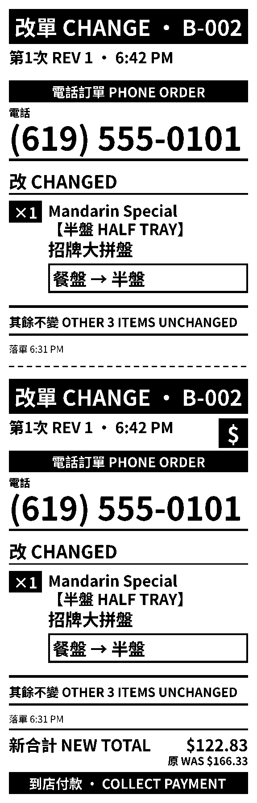 | 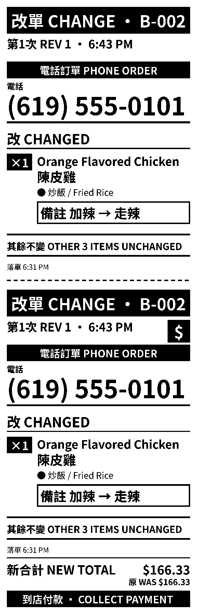 |

- Same width, font, copies and header as the kitchen ticket. The order-number
  line is replaced by an inverted band **`改單 CHANGE · B-002`** at the
  number's size (the largest type in the header), and under it
  **`第1次 REV 1 · 6:42 PM`** (revision and the time it was saved). The
  channel band, the phone, the web customer name and the time box follow as
  on the kitchen ticket, so the pass matches it to the first ticket the same
  way.
- Blocks, each only if non-empty, each with a heading ruled underneath:
  - `+ 加 ADDED`: lines exactly as a kitchen line (qty, English, 中文 large,
    size chip, rice / options, note box).
  - `- 減 REMOVED`: the same layout, every name row struck through with a 6px
    bar, so a torn half still says "not this". No price.
  - `改 CHANGED`: the dish as it is now, then one boxed line per thing that
    moved, in large type: `2 → 3`, `餐盤 → 半盤`, options `白飯 → 炒飯`,
    `備註 加辣 → 走辣`.
- Footer: `其餘不變 OTHER N ITEMS UNCHANGED` (N counts dishes by quantity, as
  the card's "4 項" does), then `落單` placed time.
- **Money (deviation from the spec's footer).** The kitchen copy carries no
  money, the rule in `copies.ts` since 2026-11-20. The register copy ends with
  `新合計 NEW TOTAL $122.83`, `原 WAS $166.33` and the COLLECT PAYMENT bar.
- A **note-only** edit prints a change ticket with just the `改` block holding
  the note line, as asked.
- Prints to the order's own station (`print_station`), through the same
  claim / delivery / confirm pipeline, so failover, the dedup by delivery id,
  segments and the 410-after-confirm all apply unchanged.

### Receipt and 重印 of an edited order

The **Receipt** view always renders the current contents. Once an order has
been edited (`revision > 0`), the full ticket carries a small inverted chip
`已改 第1次 REVISED` beside the number (`ticket-5-receipt-revised.png`).
An unedited order renders byte-identically to today.

A **重印** of an edited order prints the full current ticket with the same
chip. The Reprint dialog gains a second choice when the order has change
tickets: `重印改單 第N次 Reprint change N`, which prints the stored change
ticket again, byte-identical.

## D. Data

### Migration 017_order_revisions.sql

```sql
alter table orders add column if not exists revision int not null default 0;
alter table orders add column if not exists edited_at timestamptz;
-- The revision the FIRST kitchen ticket was handed to a printer at. NULL until
-- the first hand-over: while it is NULL an edit replaces the queued ticket
-- instead of printing a change ticket (see "unprinted" below).
alter table orders add column if not exists ticket_revision int;
-- A change ticket waiting for, or being printed by, the printer. Like
-- reprint_delivery_id: set by the save, cleared when it prints or gives up.
alter table orders add column if not exists change_ticket_id uuid;

create table if not exists order_revisions (
  id          bigserial   primary key,
  order_id    bigint      not null references orders (id) on delete cascade,
  tenant_id   text        not null,
  -- The version this row holds: a snapshot of version `revision`, written by
  -- the save that produced revision + 1. Revision 0 is the order as placed.
  revision    int         not null,
  items       jsonb       not null,
  totals      jsonb       not null,
  staff_note  text,
  -- The edit that superseded this version: when, by whom, and its diff
  -- (OrderLinesDiff, revision -> revision + 1). History reads these.
  created_at  timestamptz not null default now(),
  actor       text        not null,
  diff        jsonb       not null,
  -- The POS's key for the Save press: a retried or double-tapped Save with the
  -- same key is the same edit, never a second one.
  edit_token  text        not null,
  constraint order_revisions_revision_check check (revision >= 0)
);
create unique index if not exists order_revisions_order_rev_uniq
  on order_revisions (tenant_id, order_id, revision);
create unique index if not exists order_revisions_token_uniq
  on order_revisions (tenant_id, edit_token);

-- What a change ticket prints, frozen at save time, so every print of it
-- (the first, a retry, a 重印) is the same bytes.
create table if not exists order_change_tickets (
  id             uuid        primary key,
  order_id       bigint      not null references orders (id) on delete cascade,
  tenant_id      text        not null,
  from_revision  int         not null,
  to_revision    int         not null,
  payload        jsonb       not null,   -- OrderChangeTicket
  created_at     timestamptz not null default now(),
  updated_at     timestamptz not null default now(),
  first_offered_at timestamptz,          -- first hand-over; NULL = may still merge
  printed_at     timestamptz,
  failed_at      timestamptz,
  alerted_at     timestamptz,
  constraint order_change_tickets_range_check check (to_revision > from_revision)
);
create index if not exists order_change_tickets_order_idx
  on order_change_tickets (tenant_id, order_id);

-- Which body a hand-over carried. NULL on every existing row = the kitchen
-- ticket, so nothing already stored changes meaning.
alter table print_deliveries add column if not exists change_ticket_id uuid;
alter table print_deliveries add column if not exists ticket_revision int;
create index if not exists orders_change_pending_idx
  on orders (tenant_id, created_at) where change_ticket_id is not null;
```

Safe in either order with the deploy, like 011 and 016: old code ignores the
new columns (all nullable or defaulted); new code without 017 fails only the
edit route (the board hides Edit when `GET /api/kitchen/orders` reports
`editable: false`). `down_017_to_016.sql` drops exactly these.

`schema.sql` gains the same lines; `verify:station-migrations`
(already failing on `main` for baseline drift, per the #14 hand-over note) is
not made worse.

### Save: one transaction

`saveOrderEdit(tenantId, orderId, { baseRevision, editToken, lines, actor })`
in `repository.ts`:

1. `select … from order_revisions where tenant_id and edit_token` → found:
   return that save's result (`duplicate: true`). A double tap or a network
   retry never makes a second revision or a second ticket.
2. `select … from orders where id for update`.
   - `CANCELLED`, or `COMPLETED` with `done_at` older than 30 minutes →
     `not_editable`.
   - `revision <> baseRevision` → `conflict`: "此單已在另一部平板修改，請重新開啟
     This order was changed on another tablet, reopen it." (The token check
     comes first, so a retry of the save that WON is never reported as a
     conflict.)
3. Price the new lines (below). Zero lines → `empty` ("use Cancel").
4. `diff = diffOrderLines(order.items, newItems)`; empty → `no_changes`.
5. `insert into order_revisions` (snapshot of the current row as revision
   `r`, the diff, actor, token).
6. `update orders set items, totals, revision = r + 1, edited_at = now(),
   staff_note = <appended for web orders>, updated_at = now()
   where id and revision = r`.
7. The print side (below): replace the queued ticket, or create / widen a
   change ticket.
8. Commit, return `{ order, revision, diff, changeTicket | null, replaced }`.

`dryRun: true` runs steps 2 to 4 and returns the would-be diff and totals
without writing (the confirm sheet).

### Pricing

The client never sends a price; the request is the same `StaffLine[]` the POS
sends for a new order. The server:

- **Unchanged and quantity-changed lines** (same `lineKey`) keep their stored
  snapshot: names and `unitCents` as on the order, `lineCents = unit × qty`.
  An edit to add egg rolls must not reprice, rename or refuse the dishes the
  kitchen is already cooking because the menu moved since (a price change, a
  dish 86'd at 7pm). **Open question 2.**
- **New and changed lines** go through `composeOrder` exactly as a new order,
  with `allowStaffOnly: true` and
  `lunchAllowed = isLunchService(order.createdAt) || lunchOverride || bypass`:
  the ORIGINAL order time decides lunch eligibility, so an 11:40 lunch order
  edited at 3:10 can still swap a lunch special.
- Subtotal = sum of lines; tax with the tenant rate through `taxCents`, as
  every order. The edit has no control for either.

### Printing: which case applies

The rule hangs on one question: **could the kitchen already have paper for
this order?**

**Not yet fetched = never handed over** (`orders.ticket_revision is null`).
`print_deliveries.fetched_at` cannot answer it: in production the printer
fetches the job body straight from R2 and that GET never reaches the Worker
(see `recordDeliveryFetch`), so an unfetched-looking delivery may well be on
paper. The only safe "unprinted" is "no body was ever offered", which the
claim records by stamping `ticket_revision` in the same statement that
creates the first delivery. The save holds the order row `for update`, and the
claim's update takes the same row lock, so the two serialize: either the save
wins and the claim renders the new contents, or the claim wins and the save
sees `ticket_revision` set.

| Order state at save | What prints |
| --- | --- |
| Never handed over (`ticket_revision` null: printer offline, queued) | **No change ticket.** The order row now holds the new contents, so the first ticket the kitchen sees is already right. |
| `PRINT_FAILED` (gave up; the board says it did not print) | Same as above: `ticket_revision` is reset to null and nothing new is queued; the staff's 重印 prints the current full ticket. |
| Handed over at least once (`PRINTED`, `ACCEPTED`, or `QUEUED` with a delivery out) | **Change ticket** from the revision the kitchen has to the new one. |
| A change ticket is pending and **never handed over** | **Merge**: widen it to the new revision (`to_revision`, payload recomputed from `from_revision`). One ticket, not two. |
| A change ticket is in a live delivery window (seconds) | **Refused**, retry shortly: "改單正在列印 A change is printing, try again in a moment", the same rule 重印 follows since the A-001 incident. |
| A change ticket was handed over, window expired, unconfirmed | A **new** change ticket from that ticket's `to_revision`; the old one keeps retrying. (If it in fact printed and only its confirmation was lost, the kitchen gets that one twice, which is today's behaviour for any unconfirmed ticket.) |
| `COMPLETED` (within 30 min) | Revision recorded, **no change ticket by default**: the food has gone. The confirm sheet has `列印改單 Print change ticket` off. **Open question 3.** |

**A ticket body is always rendered at a fixed revision.** Once the first
ticket has been offered at revision 0, its retries render revision 0 (from
`order_revisions`), not the edited contents; otherwise a retry after an edit
would print the new contents AND the change ticket would print the same
change again. The hand-over row records `ticket_revision`.

### How a change ticket travels

It is a third way an order "needs paper", next to the first print and a 重印
copy, in `needsPaperFrom`:

```
or (orders.change_ticket_id is not null
    and orders.status <> 'CANCELLED'
    and orders.print_station = any(<stations>))
```

When an order needs more than one body, the claim serves them in this order:
first ticket, then change tickets (oldest first), then a 重印 copy. Each
hand-over row records what it carried (`change_ticket_id`), and the confirming
DELETE clears exactly that pointer (`change_ticket_id`, stamps
`order_change_tickets.printed_at`) and never moves the order's status, like a
reprint. The board's `printPendingSince` / "did not print" banner covers a
pending change ticket the same way, worded `改單未印出 Change ticket did not
print`.

**Failure path.** A change ticket shares the order's attempt cap. At the cap
it is marked `failed_at`, its pointer is cleared, the card goes red, and
`findUnprintedForAlert` gains a second branch for change tickets (failed, or
pending longer than the alert threshold, `alerted_at` null), so the owner is
texted exactly as for an unprinted kitchen ticket. `verify:print-recurrence`
covers it.

**Reprint of a change ticket** is a `manual_reprint` request row with
`change_ticket_id` set; the copy renders the stored `payload`, so it is the
same bytes (asserted in `verify:edit-order`).

### API

- `POST /api/kitchen/orders/[id]/edit`: staff session guard (as every
  kitchen route), body `{ baseRevision, editToken, lines, lunchOverride?,
  dryRun? }` (strict zod, no prices). Answers `{ ok, revision, diff,
  totals, changeTicket, replaced, duplicate }`, or `409 conflict`,
  `409 change_printing`, `422 no_changes | empty | not_editable`.
- `GET /api/kitchen/orders/[id]/revisions`: the order's revisions, newest
  first, each with time, actor, its diff and the totals before and after.
- `GET /api/kitchen/orders` gains `revision`, `changeCount`,
  `changePending` per order, and `editable`.
- `POST /api/kitchen/orders/[id]` `action: "reprint"` gains optional
  `changeTicketId`.

`actor` is `"kitchen"` today: the board is one shared password with no
per-person identity (`kitchenSession.ts`), as for 重印.

## E. History

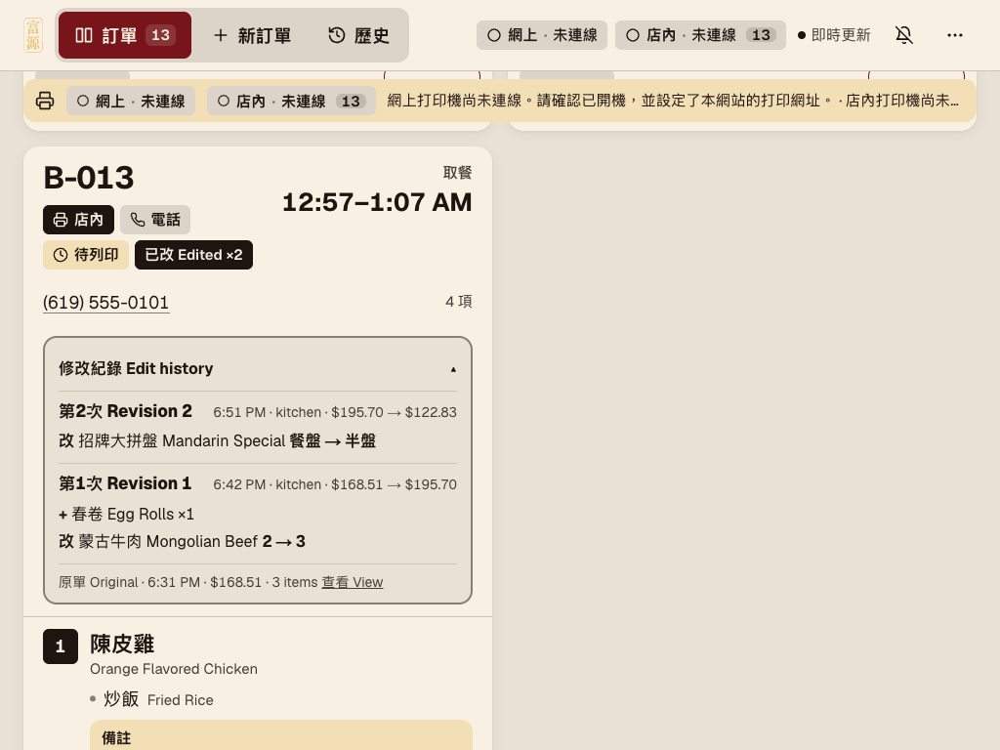

Cards of edited orders show `已改 Edited ×N`. The card expands a
`修改紀錄 Edit history` panel (loaded from `/revisions` on open): newest first,
`第N次 Revision N`, time, actor, total before → after, and its diff in the
same + / - / 改 words as the ticket; the last row is the original with a
`查看 View` that shows the order as placed.

The 日結 daily report (PR #14) sums each order's current totals, so an edited
order counts at its new total. That is the intended reading; no change there.

## Edge cases

- **Two tablets**: optimistic lock on `revision`; the second Save gets the
  conflict message and a `重新開啟 Reopen` button that reloads the order into
  edit mode (the draft is lost; the confirm sheet showed it).
- **Double tap / retry**: `edit_token` unique; same answer, one revision, one
  ticket.
- **Remove every line**: refused, Cancel exists.
- **Note only**: change ticket with just the 改 block.
- **Quantity and size together** (2 餐盤 → 3 半盤): printed as a remove plus an
  add. Two plain lines beat one the wok must parse.
- **Two lines of the same dish** (the POS split them): one dish for the diff,
  quantities summed.
- **Edit then undo the edit by hand** (add egg rolls, save; remove them,
  save): two change tickets, + then -. Correct, and what the kitchen needs.
- **Edit during failover**: the change ticket follows `print_station`, so it
  goes where the order now prints.
- **Web customer**: not notified by text. The confirm sheet says the amount
  moved; staff call if needed. Their confirmation page shows the current
  contents.
- **An item 86'd since the order**: an untouched line keeps printing; adding
  it fresh is refused as on a new order.
- **Lunch**: the original order time decides (above).

## Phase 2 plan

1. Migration 017 + `schema.sql` + README; repository `saveOrderEdit`,
   `listRevisions`, the claim / confirm / alert changes. `verify:edit-order`
   against the embedded DB: the transaction, idempotency, the lock, the lunch
   rule, unprinted-replace, merge, the refusal in a live window, and a change
   ticket reprint byte-identical.
2. Ticket: `change` kind (done here in the renderer); `verify:ticket-glyphs`
   (passes now), `verify:print-deliveries` and `verify:print-recurrence` for
   the change path.
3. API routes above.
4. UI: OrderCard action + shortcut, PosScreen edit mode, confirm sheet,
   History panel; every string through `t()` (new keys under `edit.*`),
   `verify:kitchen-i18n`.
5. Playwright (kitchen-tablet + kitchen-ipad): the cases in the spec, plus the
   layout rules at all four viewports with the edit header and the confirm
   sheet open.
6. typecheck, typecheck:worker, lint, every `verify:*`.

Existing kitchen ticket, 重印 of unedited orders, 加菜, and Cancel are not
changed.

## Open questions

1. **Branch base for Phase 2.** Cut from `pos-portion-preloader-keypad`
   (#13, edit mode needs its PosScreen; recommended), from `main` (edit mode
   would be written against the old strip and redone), or wait for #13 to
   merge?
2. **Untouched lines keep their stored price** (recommended), or recompute
   every line from today's menu as the spec says? Recomputing means a price
   change or an 86 since the order breaks or reprices the edit.
3. **Editing a COMPLETED order** (owner fixing a mistake within 30 min):
   record only, with an opt-in "print change ticket" (recommended), or always
   print?
4. **Money on the change ticket**: only on the register copy, per the
   no-money kitchen copy rule (recommended), or the spec's footer total on
   both copies?
